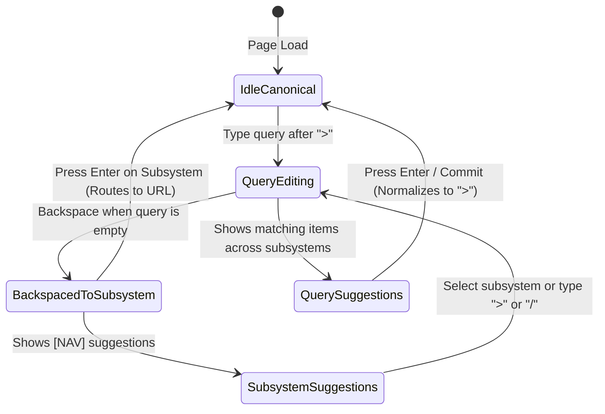
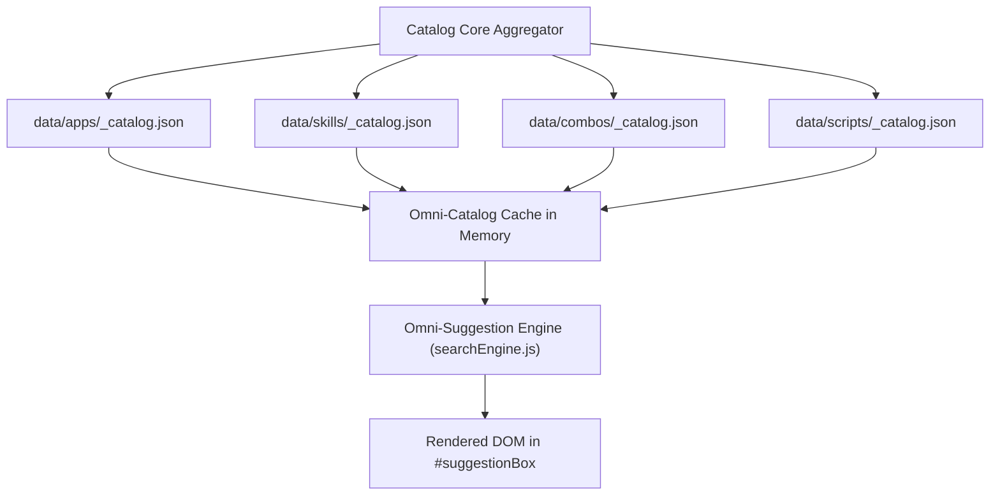

# Architectural Brief: Interactive CLI Breadcrumb Search & Omni-Suggestions
**Document Version**: `v01-02-03`  
**Subsystem**: Navigation Bar, Breadcrumb CLI Prompt & Omni-Search Suggestions  
**Status**: APPROVED_IMPLEMENTED  
**Protocol Compliance**: `ai-code-editing-iteration-flow` & `avoid-repetitive-css-important`  

---

## 1. Executive Summary & Problem Definition

In the Retro IT Knowledge Arcade interface, the top navigation header features a breadcrumb bar styled as an authentic vintage CLI terminal prompt:

```text
+---------------------------------------------------------------------------------------------------------+
| [🏠 home] / [apps] > [ typed query ][|]                    [⛶ Fullscreen] [🔍 Search] [☀️/🌙 Theme]      |
+---------------------------------------------------------------------------------------------------------+
```

While the DOM provides an inline ghost input (`#topSearchInput`), a typing slot (`#terminalTypedText`), and an unrendered popover container (`#suggestionBox`), the current search interaction only performs a local in-page card filter on the active page. 

The user requires a full interactive CLI navigation and search experience that allows:
1. **Manual typing directly inside the breadcrumb CLI prompt** with immediate real-time feedback.
2. **Unified Terminal Backspace & Delimiter Editing**:
   - The user can backspace backwards through the prompt delimiter `>` into the subsystem name:
     `apps > title` $\xrightarrow{\text{backspace}}$ `apps > ` $\xrightarrow{\text{backspace past >}}$ `app|`.
   - Allows typing `/` as an alternative to `>` (e.g., `apps / title` or `apps/title`).
   - On `[Enter]`, reload, or search commitment, the prompt canonicalizes back to standard `>` delimiter (`home / [subsystem] > [query]`).
3. **Omni-Suggestion Popover (`#suggestionBox`)**:
   - **Subsystem Navigation Autocomplete**: Typing subsystem tokens (e.g., `app|`, `skill|`, `home|`) provides immediate directory routing recommendations.
   - **Cross-Subsystem Item Matching**: Typing a cartridge or directive title (e.g., `atitle`) queries across all 4 subsystems (`apps`, `skills`, `combos`, `scripts`) and presents selectable item links (`atitlefromaskillorapp`).
4. **Full Keyboard Accessibility**: Arrow navigation (`[↑]`, `[↓]`), autocompletion (`[Tab]`), execution (`[Enter]`), and dismissal (`[Escape]`).

---

## 2. Interaction Model & User Scenarios

```text
+-------------------------------------------------------------------------------+
|                      CLI BREADCRUMB INTERACTION FLOW                          |
+-------------------------------------------------------------------------------+
|                                                                               |
|  [ USER FOCUSES BREADCRUMB PROMPT ]                                           |
|  Clicking prompt bar or pressing [*] places caret at interactive CLI line     |
|                                                                               |
|  SCENARIO A: Backspace past `>`           SCENARIO B: Delimiter Flexibility   |
|  Prompt: "apps > title"                   User types: "apps / circle"         |
|  User hits Backspace at start of query    User types: "skills > git"          |
|  Prompt deletes `>` and becomes:          Both `/` and `>` accepted as valid  |
|  "app|" -> suggests subsystems            subsystem/item separator tokens     |
|            |                                           |                      |
|            v                                           v                      |
|  +-----------------------------------+   +---------------------------------+  |
|  | #suggestionBox                    |   | #suggestionBox                  |  |
|  | [NAV] 💾 /apps/ (Cartridges)      |   | [APP] Unit Circle Resolver      |  |
|  | [NAV] ⚡ /skills/ (Directives)    |   |       Math & Canvas • 6.8 KB    |  |
|  | [NAV] 🔄 /combos/ (Pipelines)     |   | [SKILL] Git Workflow Directives |  |
|  +-----------------------------------+   +---------------------------------+  |
|            |                                           |                      |
|            +--------------------+----------------------+                      |
|                                 |                                             |
|                                 v                                             |
|  [ CANONICALIZATION ON COMMIT (ENTER / RELOAD) ]                              |
|  - Any active `/` delimiter or raw command auto-formats to standard `>`       |
|  - Result: "home / apps > clean query"                                        |
+-------------------------------------------------------------------------------+
```

### Scenario 1: Backspacing Through `>` into Subsystems (`app|`)
- **Initial State**: User is on `apps/` with prompt reading: `home / apps > `.
- **Action**: User presses `Backspace` when the query field is empty.
- **Behavior**:
  1. The caret backspaces past `>`, collapsing the static separator.
  2. The input line unifies into an editable command buffer showing `apps ` or `app|`.
  3. `#suggestionBox` opens showing subsystem navigation targets:
     - `[NAV] 💾 /apps/ - Standalone Cartridge Web Apps (1 Disks)`
     - `[NAV] ⚡ /skills/ - Modular Agent Directives`
     - `[NAV] 🔄 /combos/ - Workflow Pipelines`
     - `[NAV] 🛠️ /scripts/ - Context Ops & CLI Automations`
     - `[NAV] 🏠 /index.html - Arcade Master Hub`
- **Execution**: Pressing `[Enter]` on any suggestion navigates to that subsystem directory.

### Scenario 2: Alternative Delimiter (`/` as alternative to `>`) & Instant Post-Slash Suggestions
- **Input**: User types `apps / circle` or `skills / prompt` or `combos>pipeline`.
- **Parser Engine**: The parser treats both `/` and `>` identically as subsystem delimiters:
  - Token 1 (Subsystem): `apps`
  - Delimiter: `/` or `>`
  - Token 2 (Query): `circle`
- **Instant Suggestions Right After `/` or `>`**:
  - When the user types `apps/` or `skills/` or `combos/` or `scripts/` (query still empty), `#suggestionBox` **immediately triggers** showing all items contained inside that subsystem (e.g. `[APP] Unit Circle Resolver`).
  - When the user types `/` or `>` alone without a prefix, `#suggestionBox` triggers showing all available subsystem routes (`apps/`, `skills/`, `combos/`, `scripts/`, `home/`).
- **Live Feedback**: In-page or cross-subsystem items matching `circle` filter dynamically as the user types after the slash.
- **Live Feedback**: In-page or cross-subsystem items matching `circle` filter dynamically.
- **Canonicalization on Commit**: When the user presses `[Enter]`, reloads, or blurs with an active search, the delimiter strictly standardizes back to `>`:
  `home / apps > circle`.

### Scenario 3: Cross-Subsystem Title Query (`atitlefromaskillorapp`)
- **Input**: User is in `apps/` and types `prompt` or `resolver`.
- **Suggestions Triggered**:
  - `[APP] Unit Circle Resolver (MATH & CANVAS • 6.8 KB)` -> Direct link to detailed playground / standalone runner.
  - Matches from `skills/`, `combos/`, `scripts/` displayed with distinctive subsystem badges.
- **Action**: Clicking or pressing `[Enter]` on a cross-subsystem item navigates directly to that item in its respective subsystem.

---

## 3. Terminal Prompt Architecture & Parser State Machine



### 3.1 Input Parsing Rules
1. **Raw Input Buffer**: The input field manages the text right of `home /`.
   - Default: `apps > `
   - User Backspaces: `app|`
   - User types with slash: `apps / `
2. **Regex Parsing Engine**:
   ```javascript
   // Matches: "<subsystem> [>/] <query>" OR raw "<query>" OR "<subsystem>"
   const promptRegex = /^(apps|skills|combos|scripts|home)?\s*([>/])?\s*(.*)$/i;
   ```
3. **Delimiter Equality**:
   - In typing mode, `>` and `/` are parsed identically.
4. **Canonical Normalization**:
   - Committing via `Enter` or page reload formats the prompt line to:
     `<a href="../index.html">home</a> / <span class="prompt-folder">${subsystem}</span> > <span class="typed-query">${query}</span>`.

---

## 4. Data Architecture & Indexing Strategy

To enable instant client-side omni-suggestions across all 4 subsystems without separate network requests on every keypress:



### 4.1 Catalog Index Schema
```typescript
interface SearchIndexEntry {
  id: string;             // 'radiansincostan'
  title: string;          // 'Unit Circle Resolver'
  subsystem: 'apps' | 'skills' | 'combos' | 'scripts';
  category: string;       // 'MATH & CANVAS'
  overview: string;       // Short description
  tags: string[];         // ['edu', 'tools', 'electron']
  size: string;           // '6.8 KB'
  url: string;            // Absolute or relative destination
}
```

### 4.2 Subsystem Navigation Registry
```typescript
interface NavDestination {
  key: string;            // 'apps', 'skills', 'combos', 'scripts', 'home'
  title: string;          // 'Vibe-Coded Software Arcade'
  path: string;           // '/apps/', '/skills/', '/combos/', '/scripts/', '/'
  icon: string;           // '💾', '⚡', '🔄', '🛠️', '🏠'
  desc: string;           // 'Standalone web cartridges'
}
```

---

## 5. UI/UX & CSS Theme Styling

The suggestions popover will occupy `#suggestionBox`, positioned directly beneath `#cliPromptLine` within `#stickyNavbar`:

1. **Bevel Window Styling**:
   - Native vintage computer theme bevel:
     ```css
     background-color: var(--background-secondary);
     border: var(--border-width, 1px) solid var(--outline-color, rgba(0, 0, 0, 0.4));
     box-shadow: var(--box-shadow);
     border-radius: var(--window-border-radius, 6px);
     ```
2. **Item Row Layout**:
   - Left: Subsystem Type Badge (`[NAV]`, `[APP]`, `[SKILL]`, `[COMBO]`, `[SCRIPT]`) with accent background.
   - Center: Title with matching substring highlighted in `var(--interactive-accent)`.
   - Right: Metadata pill (Category, File Size, or Route Target).
3. **Active/Hover State**:
   - `.suggestion-item.is-selected`: Inverted background (`var(--interactive-accent)`) with dark text (`#0d0f0c`) replicating a vintage BIOS/DOS cursor highlight bar.
4. **Footer Instruction Line**:
   - Keycap hints: `[↑↓] Navigate | [ENTER] Select | [TAB] Complete | [ESC] Close`.

---

## 6. Non-Destructive Phased Implementation Plan

When the user grants explicit permission to proceed with implementation (`lets code`), the changes will be executed according to `ai-code-editing-iteration-flow.md`:

- **Phase 1: Catalog Aggregation**
  - Update `src/modules/build-bundle.js` to compile an embedded search index of all 4 subsystems or load them asynchronously into a lightweight global catalog cache.
- **Phase 2: Terminal Prompt Delimiter & Backspace Engine**
  - Implement unified input listener allowing `Backspace` to delete `>` into the subsystem name (`apps >` $\rightarrow$ `app|`).
  - Support `/` as an interchangeable delimiter during live typing.
  - Implement commit normalizer returning delimiter to standard `>` on `Enter` / reload.
- **Phase 3: Suggestion Engine Logic**
  - Expand `src/modules/searchEngine.js` with `queryOmniSuggestions(query, catalog, currentSubsystem)` returning ranked navigation and item results.
- **Phase 4: Event Listeners & Keyboard Handler**
  - Wire input events on `#topSearchInput` to dynamically render `#suggestionBox`.
  - Attach keydown listeners for `ArrowDown`, `ArrowUp`, `Enter`, `Tab`, and `Escape`.
- **Phase 5: Real Rendered DOM Verification**
  - Test in headless Edge via CDP across both Dark and Light modes.
  - Verify zero `!important` tags and rule compliance.

---

> [!IMPORTANT]
> **CODE EXECUTION FREEZE ACTIVE**: No source code files in `src/`, `data/`, or `public/` have been altered. This document serves as the updated design blueprint for review. Implementation begins only upon user confirmation.
